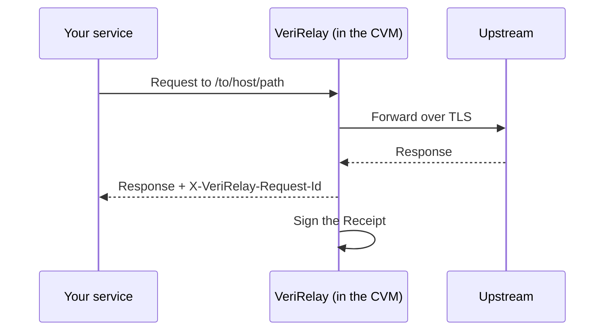

<div align="center">
  <picture>
    <source media="(prefers-color-scheme: dark)" srcset="docs/assets/logo-verirelay-dark.svg">
    
  </picture>

  <p>Turn your promise into proof: every API request you forward gets a verifiable Receipt, showing the response came from the real Upstream, untouched</p>

  <p>
    <a href="https://github.com/verirelay/verirelay/actions/workflows/ci.yml"></a>
    <a href="LICENSE"></a>
  </p>

  <p>English | <a href="README.zh-CN.md">简体中文</a></p>
</div>

## 💡 What is VeriRelay?

VeriRelay lets any service that calls APIs on its customers' behalf prove that it sends each request to the real Upstream and returns the response unaltered.

Your customers can't see what happens between your service and the Upstream. Until now, whether a response really came from the provider they paid for, unmodified, has rested on your word alone.

Put VeriRelay between your service and the Upstream, and every forward gets a Receipt that anyone can verify. The Receipt shows which Upstream answered, that the content is unchanged, and which source code VeriRelay runs.

## ✨ Features

**What it proves**

- **Provable Upstream**: the Receipt records the domain VeriRelay actually connected to and the Upstream's TLS certificate key, so it is clear which provider answered.
- **Byte-exact content**: the Receipt holds the hashes of the request and response bodies, streaming included. A swapped model, a changed parameter or an edited response no longer matches it.

**Why it's credible**

- **Unforgeable, even by you**: the Receipt Signing Key exists only inside an AMD SEV-SNP confidential VM, isolated by hardware. That is what makes the Receipts credible.
- **Auditable code**: the Launch Measurement in the Attestation Report maps to public source code with reproducible builds.

**What your customers get**

- **Independent verification**: the Protocol is fully open. Your customers verify with the reference Verifier or their own code.
- **Evidence for disputes**: optionally keep the raw request and response, encrypted, retrievable with the key and checkable against the Receipt byte for byte.

## 🔄 How it works



1. VeriRelay forwards the request method, URL and body with sanitized headers, and returns the response unchanged.
2. Every forward gets a Receipt bound to Attestation, identified by `X-VeriRelay-Request-Id`.
3. You fetch the Receipt Evidence Bundle and hand it to your customers, and they verify it against the open Protocol.

## ❓ FAQ

<details>
<summary><strong>Is VeriRelay only for AI gateways?</strong></summary>

No. It fits any service that calls HTTPS APIs on someone else's behalf and needs to show it did so faithfully, for example:

- AI model gateways and API resellers;
- aggregators of third-party data APIs;
- agent platforms that call tools and APIs for their users;
- oracles that bring web API data on-chain.

It applies whenever the Upstream is a public HTTPS endpoint and what you need to prove is the exact request and response bodies.

</details>

<details>
<summary><strong>What does a Receipt prove to my customers?</strong></summary>

It proves that this exact request body went to this Upstream: the host, the path, and the key of its TLS certificate. It also proves that this exact status and response body came back.

The Receipt is signed by a key that exists only inside an attested CVM, and the Attestation Report shows which source code that CVM runs.

A Receipt does not cover:

- HTTP headers;
- what your service does to a request before forwarding it, or the hop from your customer to your service;
- time: the timestamp comes from the CVM's own clock, not from a trusted time source.

</details>

<details>
<summary><strong>Can we forge or edit a Receipt ourselves?</strong></summary>

No.

- The Receipt Signing Key is generated inside the CVM at startup and never leaves it. SEV-SNP keeps CVM memory out of the host's reach, and that includes you.
- The Attestation Report binds the key to the Launch Measurement of the running image. Modified code gives a different Launch Measurement, which matches no published release.
- If you forward to a different Upstream, the Receipt names that Upstream.

</details>

<details>
<summary><strong>Do our customers have to trust us, the VeriRelay maintainers, or Registry?</strong></summary>

- **Not you**: the Receipt Signing Key is out of your reach.
- **Not Registry**: it only looks up which build a Launch Measurement belongs to. The Verifier checks each Build Record's signature against a Release Key pinned in its binary.
- **Not necessarily the maintainers**: a Build Record means the release pipeline vouches for that build. Anyone who doesn't want to rely on that can rebuild the Boot Artifact Set from source and recompute the Launch Measurement, because builds are reproducible.

Either way, they trust AMD's hardware.

</details>

<details>
<summary><strong>What does a Receipt reveal about our traffic?</strong></summary>

A Receipt contains:

- the method, the Upstream host, and the path and query;
- the response status;
- the SHA-256 of both bodies;
- the Upstream's TLS key.

It holds neither the bodies nor any headers, so API keys sent in headers stay private.

The Receipt endpoints need no token: anyone who knows a request id, a random 128-bit value, can fetch its Receipt.

Only when you send the `X-VeriRelay-Store` header on a request does VeriRelay store that exchange's request and response bodies. They are encrypted with a key that is returned only in that response and that VeriRelay does not keep, so anyone without the key gets only ciphertext.

VeriRelay itself connects only to your Upstreams, your VeriProv and Redis, and the AMD KDS.

</details>

<details>
<summary><strong>Does it slow requests down?</strong></summary>

SSE streams are relayed as they arrive. Other responses are buffered (up to 64 MiB) and then relayed. VeriRelay signs the Receipt after the response has been sent, so signing adds no delay.

</details>

<details>
<summary><strong>What do we need to deploy it?</strong></summary>

An AMD EPYC server (Milan or later) with SEV-SNP enabled.

</details>

<details>
<summary><strong>What changes in our service?</strong></summary>

Send Upstream requests to `/to/<upstream-host>/<path>` with the `X-VeriRelay-Token` header. The method, query, headers, and body pass through. Each response carries `X-VeriRelay-Request-Id`.

See the [API reference](docs/api.md).

</details>

<details>
<summary><strong>How do we hand Receipts to our customers?</strong></summary>

Once the response is complete, fetch the Receipt Evidence Bundle by request id (`/v1/avr/evidence/<request_id>`). Deliver it with the response, or through your own API.

Your customers run the [Verifier](https://github.com/verirelay/verifier) on the bundle and the bodies they sent and received:

```sh
verifier check evidence.json request.bin response.bin
```

Your customers can also implement verification themselves from the [Protocol](https://github.com/verirelay/protocol).

If your customers can reach VeriRelay, you can also give them just the request id and let them fetch the bundle within the retention period.

</details>

<details>
<summary><strong>We rewrite requests or responses. Can our customers still verify?</strong></summary>

Yes, but the bodies your customers hold no longer match the Receipt, so they verify against a Raw Capture instead:

1. Send `X-VeriRelay-Store: <seconds>` when forwarding. The response carries `X-VeriRelay-Store-Id` and `X-VeriRelay-Store-Key`.
2. Hand your customers the Receipt Evidence Bundle, the Raw Capture (`/v1/avr/store/<store_id>`), and those two values.
3. They run:

   ```sh
   verifier check evidence.json capture.json --store-id "$STORE_ID" --store-key "$STORE_KEY"
   ```

The Raw Capture holds the bodies VeriRelay actually sent to and received from the Upstream, and the Verifier checks the Receipt against them.

</details>

<details>
<summary><strong>Who keeps Receipts, and for how long?</strong></summary>

VeriRelay keeps Receipts only for their retention period:

- `receipt_store.ttl_seconds` sets it, one hour by default.
- The memory store keeps at most 10,000 Receipts by default and loses them when the CVM restarts. Use Redis to keep them across restarts.
- A Raw Capture is kept for the seconds each request asks for in `X-VeriRelay-Store`, capped by `raw_store.max_ttl_seconds`.

Long-term evidence for billing, audits, and disputes is yours to keep. Within the retention period, fetch the Receipt Evidence Bundle, and the Raw Capture when you need it, and store them in your own systems.

</details>

## 📚 Documentation

| Document | Contents |
| --- | --- |
| [API reference](docs/api.md) | Routes, headers, Receipt/evidence/Attestation endpoints, status codes, SSE semantics |
| [Configuration](docs/configuration.md) | Production and development mode, production startup, Bootstrap and Config Disk, Runtime Config from VeriProv, SEV-SNP endorsements, development environment variables |
| [Development](docs/development.md) | Build, tests, the deterministic init build, CI, release |
| [Glossary](docs/glossary.md) | Canonical names and definitions used across the project |
| [Protocol](https://github.com/verirelay/protocol) | Wire formats: [`avr/1`](https://github.com/verirelay/protocol/blob/main/docs/avr1.md), [`veriprov/1`](https://github.com/verirelay/protocol/blob/main/docs/veriprov1.md), [guest files](https://github.com/verirelay/protocol/blob/main/docs/guest.md) |
| [Contributing](CONTRIBUTING.md) | Pre-PR checks and cross-repo contracts |
| [Security](SECURITY.md) | How to report a vulnerability |

## 📄 License

[Apache-2.0](LICENSE)
