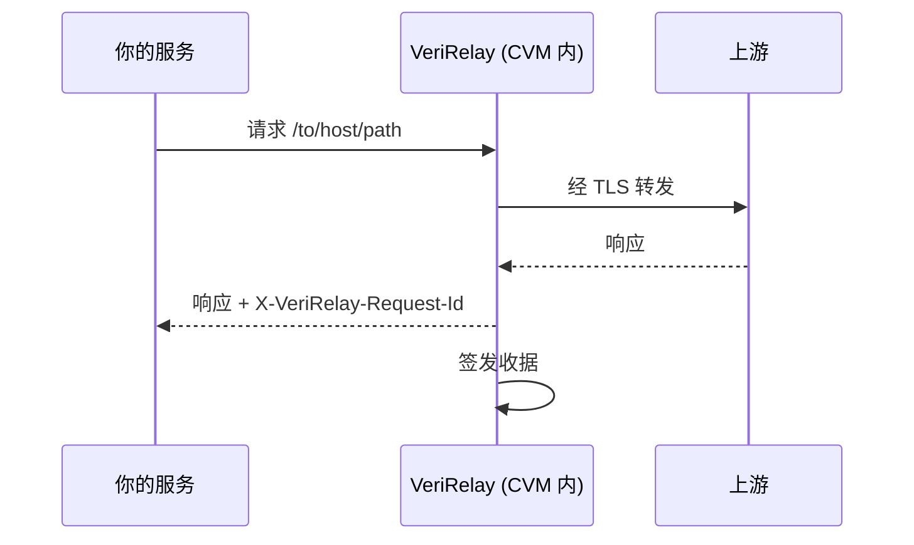

<div align="center">
  <picture>
    <source media="(prefers-color-scheme: dark)" srcset="docs/assets/logo-verirelay-dark.svg">
    
  </picture>

  <p>把承诺变成证据：每一次 API 转发都附带可验证的收据，证明响应来自真实上游，原样未改</p>

  <p>
    <a href="https://github.com/verirelay/verirelay/actions/workflows/ci.yml"></a>
    <a href="LICENSE"></a>
  </p>

  <p><a href="README.md">English</a> | 简体中文</p>
</div>

## 💡 VeriRelay 是什么？

VeriRelay 让替客户调用 API 的服务能够证明：请求确实转发给了真正的上游，响应原样返回。

你的客户看不到你的服务和上游之间发生了什么。响应是否真的来自他们付费的服务商、有没有被改过，过去只能靠你的一句承诺。

把 VeriRelay 部署在你的服务和上游之间，每一次转发都会附上一份任何人都能验证的收据：响应来自哪个上游、内容是否原样、VeriRelay 运行的是哪份源码。

## ✨ 功能

**证明什么**

- **上游身份可证明**：收据记下实际连接的域名和上游 TLS 证书公钥，响应来自哪家服务商一清二楚。
- **内容逐字节可核对**：请求和响应 body 的哈希写进收据，流式响应也一样。换模型、改参数、改响应，都会和收据对不上。

**为什么可信**

- **连你自己也伪造不了**：收据签名密钥只存在于 AMD SEV-SNP 机密虚拟机里，由硬件隔离。收据的可信正来自这一点。
- **运行的代码可复核**：证明报告里的启动度量对应一份公开、可复现构建的源码。

**客户怎么用**

- **独立验证**：Protocol 完全公开，客户用参考 Verifier 或自己的代码就能验证。
- **争议取证**：可选把请求和响应原文加密留存，凭密钥取回，和收据逐字核对。

## 🔄 工作流程



1. VeriRelay 转发请求方法、URL 和 body，并清理请求 header，再把响应原样带回。
2. 每一次转发都有一份绑定到远程证明的收据，用 `X-VeriRelay-Request-Id` 标识。
3. 你取回收据证据包交给客户，客户按公开的 Protocol 自行验证。

## ❓ FAQ

<details>
<summary><strong>只能用于 AI 中转站吗？</strong></summary>

不是。凡是替别人调用 HTTPS API，并需要证明自己如实转发的服务都可以用，例如：

- AI 模型中转站和 API 分销商
- 聚合第三方数据 API 的平台
- 替用户调用工具和 API 的 Agent 平台
- 把 Web API 数据带上链的预言机

只要上游是公网 HTTPS 接口，而需要证明的是请求和响应 body 本身，就适用。

</details>

<details>
<summary><strong>收据能向客户证明什么？</strong></summary>

证明这份请求 body 原样发给了这个上游（host、path 以及它 TLS 证书的公钥），返回的正是这个状态码和这份响应 body。

签名密钥只存在于通过远程证明的 CVM 内，证明报告则说明这个 CVM 运行的是哪份源码。

收据不覆盖：

- HTTP header
- 你的服务在转发之前对请求做的处理，以及客户到你的服务这一段
- 时间：时间戳来自 CVM 自己的时钟，不是可信时间

</details>

<details>
<summary><strong>我们自己能伪造或改动收据吗？</strong></summary>

不能。

- 收据签名密钥在 CVM 启动时于内部生成，从不离开 CVM。SEV-SNP 让宿主机读不到 CVM 内存，你也一样。
- 证明报告把这把密钥绑定到所运行镜像的启动度量上。改了代码，启动度量就变了，对不上任何公开发布的版本。
- 转发到别的上游，收据里记录的就是那个上游。

</details>

<details>
<summary><strong>客户需要信任我们、VeriRelay 的维护者或 Registry 吗？</strong></summary>

- **不需要信任你**：收据签名密钥你碰不到。
- **不需要信任 Registry**：它只负责查询启动度量属于哪个构建。Verifier 会用二进制内固定的 Release Key 校验每条构建记录的签名。
- **不一定需要信任维护者**：构建记录表示发布流水线为这个构建背书。不想依赖这一点的话，可以从源码重新构建启动产物集并自己计算启动度量，构建是可复现的。

无论哪种方式，都需要信任 AMD 的硬件。

</details>

<details>
<summary><strong>收据会暴露我们哪些流量信息？</strong></summary>

收据包含：

- 请求方法、上游 host、path 和 query
- 响应状态码
- 两份 body 的 SHA-256
- 上游的 TLS 公钥

收据不含 body 原文，也不包含任何 header。放在 header 里的 API key 因此不会泄露。

收据接口不需要 token：知道 request id（128 位随机值）的人都能取到对应收据。

只有你在请求里带上 `X-VeriRelay-Store` header，VeriRelay 才会把这一次的请求和响应 body 加密保存。解密密钥只在这次响应里返回，VeriRelay 自己不保存，没有密钥的人取到的只是密文。

VeriRelay 本身只会连接你的上游、你的 VeriProv 和 Redis，以及 AMD KDS。

</details>

<details>
<summary><strong>会拖慢请求吗？</strong></summary>

SSE 流边收边转。其他响应先缓冲（最多 64 MiB）再返回。收据在响应发完之后才签名，签名不增加延迟。

</details>

<details>
<summary><strong>部署需要什么？</strong></summary>

一台开启 SEV-SNP 的 AMD EPYC 服务器（Milan 及之后）。

</details>

<details>
<summary><strong>我们的服务要改什么？</strong></summary>

把发给上游的请求改发到 `/to/<上游 host>/<path>`，带上 `X-VeriRelay-Token` header。请求方法、query、header 和 body 都会透传。每个响应都带 `X-VeriRelay-Request-Id`。

详见 [API 参考](docs/api.zh-CN.md)。

</details>

<details>
<summary><strong>怎么把收据交给客户？</strong></summary>

响应结束后，用 request id 取回收据证据包（`/v1/avr/evidence/<request_id>`），随响应一起交给客户，或者通过你自己的接口提供。

客户拿证据包和自己发出、收到的 body，运行 [Verifier](https://github.com/verirelay/verifier)：

```sh
verifier check evidence.json request.bin response.bin
```

客户也可以按 [Protocol](https://github.com/verirelay/protocol) 自己实现验证。

如果客户能访问到 VeriRelay，也可以只给 request id，让他们在保留期内自己取。

</details>

<details>
<summary><strong>我们会改写请求或响应，客户还能验证吗？</strong></summary>

能，但客户手里的 body 和收据对不上，要改用原文留存核对：

1. 转发时带上 `X-VeriRelay-Store: <秒数>`，响应会带回 `X-VeriRelay-Store-Id` 和 `X-VeriRelay-Store-Key`。
2. 把收据证据包、原文留存（`/v1/avr/store/<store_id>`）和这两个值交给客户。
3. 客户运行：

   ```sh
   verifier check evidence.json capture.json --store-id "$STORE_ID" --store-key "$STORE_KEY"
   ```

原文留存里是 VeriRelay 实际发给上游、从上游收到的 body，Verifier 用它核对收据。

</details>

<details>
<summary><strong>收据由谁保存、保存多久？</strong></summary>

VeriRelay 只在保留期内保存收据：

- 保留期由 `receipt_store.ttl_seconds` 决定，默认 1 小时。
- memory store 默认最多保留 10000 条，CVM 重启后清空。需要跨重启保留就用 Redis。
- 原文留存的保留期由每次请求的 `X-VeriRelay-Store` 决定，不超过 `raw_store.max_ttl_seconds`。

对账、审计和处理争议需要的长期存证由你负责：在保留期内取回收据证据包，需要时连同原文留存，存进你自己的系统。

</details>

## 📚 文档

| 文档 | 内容 |
| --- | --- |
| [API 参考](docs/api.zh-CN.md) | 路由、header、收据/evidence/远程证明接口、状态码、SSE 语义 |
| [配置](docs/configuration.zh-CN.md) | 生产模式与开发模式、生产模式启动、引导文件与配置盘、来自 VeriProv 的运行配置、SEV-SNP endorsements、开发模式环境变量 |
| [开发](docs/development.zh-CN.md) | 构建、测试、确定性 init 构建、CI、发布 |
| [术语表](docs/glossary.zh-CN.md) | 全项目统一的名词与定义 |
| [Protocol](https://github.com/verirelay/protocol) | 线格式：[`avr/1`](https://github.com/verirelay/protocol/blob/main/docs/avr1.zh-CN.md)、[`veriprov/1`](https://github.com/verirelay/protocol/blob/main/docs/veriprov1.zh-CN.md)、[guest 文件](https://github.com/verirelay/protocol/blob/main/docs/guest.zh-CN.md) |
| [贡献](CONTRIBUTING.md) | 提交 PR 前的检查与跨仓库契约 |
| [安全](SECURITY.md) | 如何报告漏洞 |

## 📄 License

[Apache-2.0](LICENSE)
